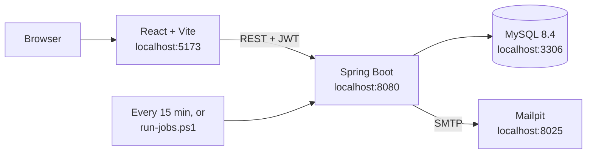

# SubTrack

Track every subscription you pay for (insurance, mobile recharges, OTT, AI tools, internet, utilities) in one place, get email reminders before each renewal, and record whether each bill was **paid** or **missed**.

Built with **React 19 + Tailwind CSS** and **Spring Boot 4 + MySQL**. It runs entirely on one Windows PC: no Docker, no cloud services.

- Full design: [SubTrack_Project_Plan.md](SubTrack_Project_Plan.md)
- Build progress, phase by phase: [BUILD_PLAN.md](BUILD_PLAN.md)

## Features

- **Subscriptions**: add, edit, pause, cancel; categories, billing cycles (monthly to yearly, or one-time), amounts in ₹ with Indian digit grouping
- **Paid / Missed tracking**: every due date is a billing cycle you mark as paid (with date and amount) or missed; corrections are kept in a change log
- **Status dashboard**: tiles for overdue, due soon, awaiting confirmation, paid and missed this month; one table of every subscription with quick Mark Paid / Mark Missed; charts of spend by category and paid vs missed over time
- **Reminders**: emails 30/15/7/3/1 days before each due date (configurable), around 9 AM in your timezone, plus one "did you pay?" nudge when a bill goes unmarked
- **Accounts**: email verification, password reset, short-lived access tokens with rotating refresh tokens

## Running on another PC (from the shared zip)

Needs **Windows 10/11**, **JDK 17 or newer** (`java -version`), **Node.js 20 or newer** (`node -v`) and an internet connection for the first run. No Docker, no admin rights.

Unzip, open PowerShell **inside the `SubTrack` folder**, then:

```powershell
Set-ExecutionPolicy -Scope Process Bypass   # allow the project's scripts in this window
.\scripts\dev-services.ps1 setup            # first time: downloads MySQL + Mailpit (~300 MB) and creates the databases
.\scripts\start-demo.ps1                    # starts everything and opens http://localhost:5173
```

The first start also downloads the Java and npm libraries, so it takes a few minutes; later starts take about a minute. If MySQL won't start, install the free "Microsoft Visual C++ Redistributable (x64)" and run `setup` again. To share an updated copy, run `.\scripts\make-zip.ps1`.

## Demo on this PC

Requirements: **JDK 17+** and **Node 20+**. Maven comes with the project (`mvnw`). MySQL and Mailpit are portable copies in `.tools/`.

**First time only**, set up the database:

```powershell
.\scripts\dev-services.ps1 setup
```

**Every demo**, start everything with one command:

```powershell
.\scripts\start-demo.ps1
```

It starts MySQL and Mailpit, opens the backend and frontend in their own windows, and opens the browser when they're ready.

| What | Where |
|---|---|
| The app | http://localhost:5173 |
| Demo login | **demo@subtrack.app / demo-password** (12 subscriptions in every status) |
| Emails sent by the app | http://localhost:8025 (Mailpit, a developer tool that catches the app's emails; it is not part of SubTrack's UI) |

The demo account is **reset to the same fresh state every time the backend starts**, so each client sees a clean dashboard. (Set `app.demo.reset-on-start=false` to keep changes between runs.)

**Suggested demo flow**

1. Log in as the demo user. The dashboard shows overdue, due-soon, awaiting-confirmation, paid and missed subscriptions, plus the charts.
2. Mark the overdue **Jio Recharge** as paid from the table; the tiles and its row update straight away.
3. Open **Spotify Premium** (auto-renew): the earlier cycle is waiting for confirmation; mark it paid.
4. Add a new subscription due in 3 days.
5. Run `.\scripts\run-jobs.ps1` and open Mailpit: the reminder emails are there (the demo profile sends them at any hour; normally they go out around 9 AM).
6. Register a new account to show email verification: the link arrives in Mailpit.

**When you're done:** close the "SubTrack backend" and "SubTrack frontend" windows, then run `.\scripts\dev-services.ps1 stop`.

Use `.\scripts\start-demo.ps1 -NoDemo` to start without the demo user (only accounts you register).

### Real emails (optional)

By default every email lands in Mailpit, which is safest for a demo. To deliver real emails, for example through a Gmail account with an [app password](https://support.google.com/accounts/answer/185833), set these in the PowerShell window before starting:

```powershell
$env:MAIL_HOST = 'smtp.gmail.com'
$env:MAIL_PORT = '587'
$env:MAIL_USERNAME = 'you@gmail.com'
$env:MAIL_PASSWORD = '<16-character app password>'
$env:MAIL_SMTP_AUTH = 'true'
$env:MAIL_STARTTLS = 'true'
$env:MAIL_FROM = 'SubTrack <you@gmail.com>'
.\scripts\start-demo.ps1
```

Note: the demo user's address (demo@subtrack.app) isn't a real mailbox; register an account with a real email to receive messages.

## How it works



Every 15 minutes (or when you run `run-jobs.ps1`) the backend does three things under one database lock (ShedLock):

1. **Renewal**: auto-renew subscriptions whose due date passed move to their next cycle; the past cycle waits for you to confirm it was paid.
2. **Reminders**: for each unpaid cycle, the reminder due is the *smallest reminder day ≥ days left*, so a missed run still sends the right reminder later. Each email is claimed by inserting a row under a unique key **before** sending, so it can't go out twice even if two runs overlap.
3. **Retries**: failed emails are retried after 15 min, 1 h, 4 h and 12 h, and dropped once they're no longer useful.

Due dates are always computed from an anchor date (`anchor + n × cycle`), so a bill due on 31 Jan is due 28 Feb, then 31 Mar, never drifting to the 28th.

## Development

```powershell
.\scripts\dev-services.ps1 start                 # MySQL + Mailpit
cd backend;  .\mvnw.cmd spring-boot:run          # http://localhost:8080 (add "-Dspring-boot.run.profiles=local,demo" for demo data)
cd frontend; npm install; npm run dev            # http://localhost:5173
```

| Command | What runs |
|---|---|
| `cd backend; .\mvnw.cmd test` | Unit tests + integration tests against the local `subtrack_test` database (wiped and re-migrated each run) |
| `cd backend; .\mvnw.cmd verify` | The above + fails if service-layer line coverage drops below 80% (report: `backend/target/site/jacoco/index.html`) |
| `cd frontend; npm test` | Vitest + React Testing Library |
| `postman collection run postman/SubTrack.postman_collection.json -e postman/SubTrack.local.postman_environment.json` | End-to-end API checks against the running backend |

If the project is pushed to GitHub, [.github/workflows/ci.yml](.github/workflows/ci.yml) runs the same checks there (optional; it uses the MySQL already installed on GitHub's runners).

## API

All endpoints except `/api/auth/*` need `Authorization: Bearer <accessToken>`. Errors share one shape: `{ status, error, message, path, fieldErrors }`.

| Area | Endpoints |
|---|---|
| Auth | `POST /api/auth/register · login · refresh · logout · verify-email · resend-verification · forgot-password · reset-password · change-password` |
| Profile | `GET/PUT /api/users/me` |
| Subscriptions | `GET/POST /api/subscriptions`, `GET/PUT/DELETE /api/subscriptions/{id}`, `PATCH …/{id}/status`, `PUT …/{id}/reminders` |
| Paid / Missed | `GET /api/subscriptions/{id}/periods`, `PATCH /api/subscriptions/{id}/periods/{periodId}`, `GET /api/periods/{periodId}/history` |
| Dashboard | `GET /api/dashboard/summary · status-board · category-breakdown · trend · upcoming` |
| Notifications | `GET /api/notifications` |
| Jobs | `POST /internal/jobs/run` with header `X-Job-Secret` (used by `run-jobs.ps1`) |

Full details: [SubTrack_Project_Plan.md §6](SubTrack_Project_Plan.md) and the Postman collection in `postman/`.

## Project layout

```
backend/    Spring Boot (controller → service → repository), Flyway migrations, jobs, email
frontend/   React + Vite + Tailwind; pages, components, API client with token refresh
postman/    API test collection + local environment
scripts/    dev-services.ps1 (MySQL + Mailpit), start-demo.ps1, run-jobs.ps1
.tools/     portable MySQL and Mailpit (not committed)
```
